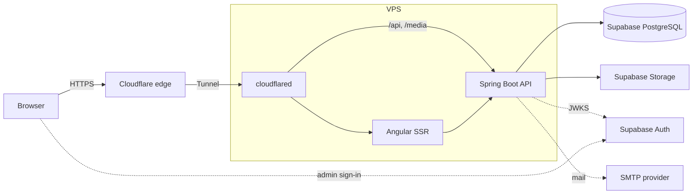

# mpospieszynski.pl — personal website

A portfolio that advertises my skillset through real projects, with freelance services and a contact form. **Polish (default) and English**, with a private admin panel for editing content without redeploying.

- **Frontend:** Angular with server-side rendering (SSR), Transloco for translations
- **Backend:** Java + Spring Boot REST API (modular monolith)
- **Platform:** Supabase — Auth (admin sign-in), PostgreSQL (content), Storage (images)
- **Hosting:** your VPS runs three Docker containers (`web`, `api`, `cloudflared`) with Docker Compose, exposed through Cloudflare Tunnel (no open web ports, no nginx); the database is Supabase, outside the VPS
- **CI/CD:** GitHub Actions (free Linux runners with Docker) and GHCR; secrets only on the VPS and in a GitHub environment
- **Edge:** Cloudflare DNS, CDN cache, WAF, Turnstile, Web Analytics

| Document | Contents |
|---|---|
| [docs/UI-UX-DESIGN.md](docs/UI-UX-DESIGN.md) | Positioning, audiences, navigation, language behaviour, design tokens, shared components, copy rules |
| [docs/screens/](docs/screens/) | **One spec per screen** (10 public, 10 admin): layout, content keys, API contract, states, technical hints, acceptance criteria |
| [docs/CONVENTIONS.md](docs/CONVENTIONS.md) | Coding conventions for frontend and backend, definition of done, prompt template |
| [docs/IMPLEMENTATION-PLAN.md](docs/IMPLEMENTATION-PLAN.md) | Build order with task IDs (B1–B6, F1–F6, S1–S10, A1–A10, I1–I4) |
| [docs/ARCHITECTURE.md](docs/ARCHITECTURE.md) | System context, deployment with Cloudflare Tunnel, Supabase setup, backend and frontend structure, i18n, data model, API, security, CI/CD, decisions |
| [docs/diagrams/](docs/diagrams/) | UML (PlantUML) and Mermaid sources with rendered SVGs |

---

## Features

**Public site (PL at `/`, EN at `/en`)**
- Home page with headline, an interactive graph of projects and the technologies they share, services, projects and a contact form
- Projects with filters and case-study pages
- Skills page where every technology and expertise area links to the projects that prove it
- About page: background and how I work (no CV, no career timeline)
- Freelance services, collaboration process, FAQ, optional availability status
- Contact form with conditional fields, Turnstile, notifications and an auto-reply in the visitor's language
- Language switcher that keeps you on the equivalent page; `hreflang` and localised URLs
- One dark theme (Emerald Ink, Syne and Manrope) with an interactive project graph on Home, WCAG 2.2 AA, SEO metadata, sitemap with language alternates

**Admin panel (`/admin`, Polish UI, owner only)**
- Supabase sign-in with MFA
- Messages inbox
- Content editors with Polish/English tabs and translation status
- Media library backed by Supabase Storage
- Skills: technologies with descriptions, expertise areas linked to projects
- Settings: headline, intro, about, approach, availability, links, portrait, auto-reply texts per language

---

## Architecture at a glance



---

## Repository structure

```
personal-website/
├── backend/                      Spring Boot API
│   ├── src/main/java/pl/mpospieszynski/site/
│   │   ├── shared/               security, web, i18n, storage
│   │   ├── profile/  projects/  skills/  services/  contact/  seo/
│   ├── src/main/resources/
│   │   ├── application.yml
│   │   ├── db/migration/         Flyway scripts (schema "site")
│   │   ├── mail/                 email templates, pl and en
│   │   └── ValidationMessages_pl.properties, ValidationMessages_en.properties
│   ├── src/test/
│   ├── Dockerfile
│   ├── build.gradle.kts, settings.gradle.kts
│   └── gradlew, gradle/wrapper/
├── frontend/                     Angular app (SSR)
│   ├── src/app/
│   │   ├── core/  shared/  features/  api/ (generated)
│   │   └── i18n/                 pl.json, en.json
│   ├── src/styles/               design tokens, typography
│   ├── Dockerfile
│   └── package.json
├── infra/
│   ├── docker-compose.yml        cloudflared, web, api
│   ├── docker-compose.dev.yml    local PostgreSQL + Mailpit
│   ├── cloudflared/config.yml    tunnel ingress rules
│   └── .env.example
├── docs/
└── .github/workflows/
    ├── ci.yml
    └── deploy.yml
```

---

## Prerequisites

- JDK 21, Node.js 24 LTS (Angular 22 needs ^22.22.3, ^24.15 or 26+), Docker with Compose
- A Supabase project (free plan)
- Your domain on Cloudflare
- An SMTP account (free plan of a transactional email provider)

---

## Working with the docs

Each screen and foundation task is specified once. A prompt for the next piece of work can be as short as:

> Implement `docs/screens/public/03-projects-list.md`. Follow `docs/CONVENTIONS.md`.

or

> Do task **B2** from `docs/IMPLEMENTATION-PLAN.md`.

Start with the foundation tasks in the order of the implementation plan.

---

## Setup

### 1. Supabase

Full steps with SQL are in [ARCHITECTURE.md § 4](docs/ARCHITECTURE.md#4-supabase). In short:

1. Create the project in the region closest to your VPS (an EU region keeps data in the EU).
2. Auth: enable your sign-in method, **disable sign-ups**, create your user, set `app_metadata.role = "admin"`, enable TOTP.
3. Database: run `infra/supabase/roles.sql` once in the SQL editor or psql (creates `site_app`, which owns the `site` schema, and the read-only `owner_ro`, without passwords), then set both passwords from your computer with psql's `\password site_app` and `\password owner_ro`. Don't add `site` to the exposed schemas.
4. Storage: create a public `media` bucket with the admin-only write policy.
5. Copy the project URL, the publishable key and the **session pooler** connection string.

### 2. Cloudflare

Everything here works on Cloudflare's **Free plan**, and no nginx is needed on the VPS: the tunnel routes by path to the containers ([ARCHITECTURE § 3](docs/ARCHITECTURE.md#no-reverse-proxy-no-subdomains)).

1. Create a locally-managed tunnel from your computer (`cloudflared tunnel login`, then `cloudflared tunnel create site`). Keep the printed tunnel id for `TUNNEL_ID` and copy the generated credentials JSON to the VPS only, as `/opt/site/cloudflared/credentials.json` (`chown 65532:65532`, `chmod 400`: the image runs as that user).
2. Route the hostnames to it: `cloudflared tunnel route dns site mpospieszynski.pl` (and `www.mpospieszynski.pl`). The ingress rules are versioned in `infra/cloudflared/config.yml`: `^/(api|media)/` and `^/(sitemap\.xml|robots\.txt)$` → `http://api:8080`, everything else → `http://web:4000`.
3. Redirect rule `www` → apex; cache rules for `/media/*` and static assets; bypass cache for `/admin*` and `/api/v1/admin/*`.
4. Turnstile: create a widget for your domain; copy the site and secret keys.
5. Web Analytics: enable it for the domain.

### 3. Local development

```bash
docker compose -f infra/docker-compose.dev.yml up -d    # PostgreSQL :5433 (DEV_DB_PORT), Mailpit SMTP :1025, inbox :8025

cd backend
./gradlew bootRun --args='--spring.profiles.active=dev'   # API :8080, local DB, sample PL+EN content

cd frontend
npm install
npm run api:generate     # regenerate the client from the running API's OpenAPI spec (--offline: from openapi/site-api.json)
npm start                # http://localhost:4200 (PL), http://localhost:4200/en (EN)
```

**Admin sign-in locally** uses the Supabase CLI (a frontend dev dependency, Docker required): Auth, its database and Studio only.

```bash
cd frontend
npm run supabase:keys    # once per machine: local ES256 signing key in supabase/signing_keys.json (git-ignored)
npm run supabase:start   # Auth on http://127.0.0.1:54321, seed users from supabase/seed.sql
```

Sign in at http://localhost:4200/admin with `admin@localhost.test` / `local-admin-password` (a TOTP-enrolled admin and a user without the admin role are seeded too, for the tests). The dev API trusts tokens from this local issuer; `npm run supabase:reset` re-seeds the users. These are local test accounts only; production uses the Supabase project's own users and keys.

The `dev` profile uses the local PostgreSQL, so you can develop offline. Point it at a second Supabase project (staging) when you want to test against the real platform. Test SSR with `npm run build && npm run serve:ssr`, with `API_INTERNAL_URL=http://localhost:8080` set (the production build calls `http://api:8080` by default).

### 4. Tests

```bash
cd backend && ./gradlew check
cd frontend && npm test && npm run i18n:check && npm run e2e
```

`i18n:check` fails if `pl.json` and `en.json` don't have the same keys.

The Playwright e2e tests (`frontend/e2e/*.e2e.ts`, one per screen spec, with axe) run against `ng serve`, which they start if it isn't running. They need the dev API with its sample content, PostgreSQL and Mailpit (the contact test reads the delivered mail), and they use the installed Chrome, so no browser download is needed. The admin tests (`frontend/e2e/admin/`) also need the local Supabase stack; they run as a second Playwright project after the public ones, one at a time, and put back any sample content they change (`npx playwright test --project=admin --no-deps` runs only them). Set `E2E_BASE_URL` to test another server.

---

## Configuration

| Variable | Used by | Description |
|---|---|---|
| `TUNNEL_ID` | cloudflared | Locally-managed tunnel id; its credentials JSON is a file on the VPS (`TUNNEL_CREDENTIALS_FILE`, default `./cloudflared/credentials.json`), not a variable |
| `REGISTRY` | compose | Image location (`ghcr.io/<github-user>`, lowercase). The deployed git SHA (`TAG`) is not in `.env`: `infra/deploy.sh` writes it to `release.env` |
| `SUPABASE_URL` | api, web | `https://<project-ref>.supabase.co` |
| `SUPABASE_PUBLISHABLE_KEY` | api, web (admin) | Publishable (anon) key; safe in the browser |
| `SUPABASE_DB_URL` | api | Session pooler JDBC URL with `sslmode=require` |
| `SUPABASE_DB_USER`, `SUPABASE_DB_PASSWORD` | api | e.g. `site_app.<project-ref>` |
| `SUPABASE_STORAGE_BUCKET` | api | `media` |
| `TURNSTILE_SITE_KEY` | web | Public widget key |
| `TURNSTILE_SECRET_KEY` | api | Server-side verification secret |
| `MAIL_HOST`, `MAIL_PORT`, `MAIL_USERNAME`, `MAIL_PASSWORD` | api | SMTP provider |
| `MAIL_FROM`, `MAIL_OWNER_TO` | api | Sender address and notification recipient |
| `IP_HASH_SALT` | api | Random secret for hashing visitor IPs |
| `SITE_BASE_URL` | api, web | `https://mpospieszynski.pl` (canonical URLs, sitemap; web falls back to the request origin) |
| `API_INTERNAL_URL` | web | API address for server-side rendering; default `http://api:8080` |

All of these live in one place: `/opt/site/.env` on the VPS (owned by the `gha` user, mode `600`), created from `infra/.env.example`, which holds placeholders only. Never commit `.env`; nothing in the repository, the images or the workflows contains a credential. No Supabase service-role key is needed anywhere in this project.

The CI/CD pipeline needs none of these. Deployments use only the GitHub environment secrets listed under [Continuous deployment](#continuous-deployment).

---

## Deployment

### One-time VPS setup

1. Non-root user, SSH key-only login, root login disabled, unattended upgrades.
2. Firewall: block all inbound traffic except SSH (or nothing at all if you deploy over SSH through Cloudflare Access).
3. Install Docker and the Compose plugin.
4. Create a `gha` user for CI in the `docker` group (Docker access is root-equivalent, so this user is the only one with it); add its public key to `authorized_keys`. Docker Compose 2.24 or newer.
5. As `gha`: create `/opt/site/cloudflared/`, put the tunnel credentials there, create `/opt/site/.env` from `infra/.env.example` (`chmod 600`), and log in to GHCR once with a read-only package token (`docker login ghcr.io`), unless the packages are public.
6. The first run of the deploy workflow copies `docker-compose.yml`, `cloudflared/config.yml` and `deploy.sh` from the commit it deploys and starts the stack. By hand, the same is `cd /opt/site && ./deploy.sh <full-commit-sha>`.

Every container has a memory limit (cloudflared 128 MB, web 512 MB, api 1 GB), a health check (`/healthz` on web, `/api/actuator/health/liveness` on the API), runs as a non-root user with a read-only filesystem, and publishes no port. Images contain no secret: the API and web read everything from the environment. To try the images without the registry: `docker build -t site-api backend` and `docker build -t site-web frontend`.

Security headers: the SSR server sends a per-request nonce CSP (Turnstile only on the contact pages, Supabase Auth only under `/admin`, Cloudflare Web Analytics everywhere) plus `Referrer-Policy`, `Permissions-Policy`, `X-Content-Type-Options` and `X-Frame-Options`; the API sends `default-src 'none'` and the same others. HSTS comes from Cloudflare (SSL/TLS → Edge Certificates).

The site is live as soon as `cloudflared` connects. No certificates or open web ports are needed.

### Continuous deployment

CI and deployment run on **GitHub Actions** (not Codemagic: its free plan is macOS-only, and this pipeline needs Linux with Docker; see [ARCHITECTURE § 13](docs/ARCHITECTURE.md#13-cicd)).

Secrets for deployments are stored in GitHub → Settings → Environments → `production` (optionally with you as a required reviewer):

| Secret | What |
|---|---|
| `DEPLOY_SSH_KEY` | Private key of the VPS `gha` user |
| `DEPLOY_HOST`, `DEPLOY_USER` | VPS address and user |
| `DEPLOY_KNOWN_HOSTS` | The VPS host key, so the connection is verified |
Environment variables (not secrets): `SITE_URL` (`https://mpospieszynski.pl`, for the health check) and, if SSH is not on port 22, `DEPLOY_PORT`. Get `DEPLOY_KNOWN_HOSTS` with `ssh-keyscan -p <port> <host>` and compare the fingerprint with the VPS console's. SSH goes to the VPS directly; deploying through Cloudflare Access is not implemented.

Images are pushed with the workflow's built-in `GITHUB_TOKEN`; no registry password is stored.

**`.github/workflows/ci.yml`** runs on every push to another branch and on every pull request, with no secrets:

| Job | What |
|---|---|
| Secret scan | gitleaks over the whole history (`.gitleaks.toml`) |
| Backend | `./gradlew check`: unit, Testcontainers, ArchUnit |
| Frontend | unit tests, i18n key check, colour contrast, production SSR build |
| End-to-end | PostgreSQL and Mailpit (`infra/docker-compose.dev.yml`), local Supabase Auth, the API with sample content, Playwright (public and admin) in Chrome |

**`.github/workflows/deploy.yml`** runs on every push to `main`:

1. CI (the workflow above).
2. Build the `site-api` and `site-web` images tagged with the full commit SHA; push them to `ghcr.io/<owner>`.
3. In the `production` environment: copy the stack files of that commit to `/opt/site` over SSH and run `deploy.sh <sha>`, which writes the tag to `release.env` (never `.env`), pulls, and waits until `web` and `api` are healthy. If they are not, it puts the previous release back and the job fails.
4. Health check of `/`, `/en` and `/api/actuator/health` through the tunnel.

**Rollback:** Actions → Deploy → Run workflow with the full SHA of an earlier commit (its images are reused, nothing is rebuilt), or on the VPS `./deploy.sh --previous`. Flyway migrations stay backward compatible to make that safe.

---

## Operations

| Task | How |
|---|---|
| Logs | `cd /opt/site && docker compose --env-file .env --env-file release.env logs -f api web cloudflared` |
| Health | `https://mpospieszynski.pl/api/actuator/health` |
| Uptime | External free monitor on `/`, `/en` and the health endpoint |
| Traffic | Cloudflare Web Analytics |
| Database, auth, storage usage | Supabase dashboard |
| Query the database from your computer | Any PostgreSQL client with the session pooler connection string and the read-only `owner_ro` role ([ARCHITECTURE § 4](docs/ARCHITECTURE.md#access-from-your-computer)) |
| Dependency updates | Renovate or Dependabot pull requests |

---

## Roadmap

**v1 – launch**
- [ ] Backend: schema with translation tables, public and admin API, Supabase JWT security, Storage integration, contact flow
- [ ] Frontend: PL and EN public pages with SSR, language switcher, design tokens (dark and light themes), admin panel in Polish and English
- [ ] Infra: Compose with cloudflared, Cloudflare rules, CI/CD
- [ ] Content: Polish content complete; English for home, featured projects, skills and about

**v2 – ideas**
- [ ] Notes/blog section reusing the project content model
- [ ] Live "new message" badge in the admin with Supabase Realtime
- [ ] Client area for freelance projects

---

## License

Code: MIT (or your choice). Content and images: all rights reserved.
