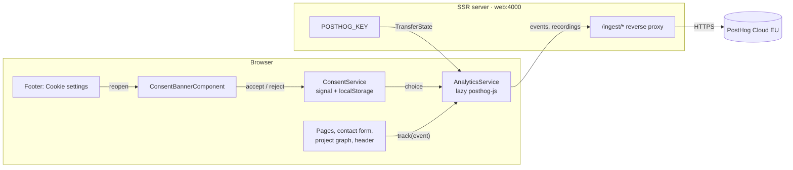

# Analytics: PostHog with consent

Status: **implemented** (ADR-014 in `ARCHITECTURE.md` §14). Analytics is off until `POSTHOG_KEY` is set on the VPS;
the rollout steps are in [§9](#9-rollout) and `TODO.MD`.

## 1. Goal

Learn how visitors use the site, without breaking the privacy promises the site makes:

- **Visitors who accept cookies:** full product analytics: page views, custom events, funnels, **heatmaps** and
  **session recordings**.
- **Visitors who reject:** as much as is possible without storing anything on their device: anonymous page views and
  custom events, counted with PostHog's cookieless server hash. No recordings, no heatmaps.
- **Never:** personal data in events, recordings of what people type, tracking in the admin, anything that delays the
  page.

Cloudflare Web Analytics (ADR-011) stays: it is free, needs no code, sees visitors whose ad blockers stop PostHog, and
is the baseline to compare PostHog numbers against.

## 2. What is collected, by consent state

| | **Accepted** | **Rejected** (or Global Privacy Control) | **Not decided yet** (banner open) |
|---|---|---|---|
| PostHog loaded | ✅ | ✅ | ❌ not even downloaded |
| Stored on the device | PostHog cookie + localStorage (anonymous visitor id), the consent choice | Only the consent choice | Nothing |
| Page views (with language, referrer, UTM) | ✅ | ✅ cookieless | ❌ |
| Custom events ([§6](#6-events)) | ✅ | ✅ cookieless | ❌ (the landing page view is captured once they decide) |
| Returning visitor recognised | ✅ across visits | Same day only (server hash) | – |
| Web vitals (LCP, CLS, INP) | ✅ | ✅ | ❌ |
| Autocapture, **heatmaps** (clicks, rage and dead clicks, scroll) | ✅ | ❌ | ❌ |
| **Session recordings** | ✅ masked ([§5.3](#53-recordings)) | ❌ | ❌ |
| Identified person profile | ❌ never (`person_profiles: 'identified_only'`, no `identify()`) | ❌ | ❌ |

Why the line is drawn there: recordings and heatmaps capture how a specific person behaves, so they wait for consent,
and so do the cookies that link visits together. Undecided visitors are not tracked at all (PostHog's documented
`cookieless_mode: 'on_reject'`). Counting rejected visitors cookielessly stores nothing on the device, but whether it
may run without consent is **not settled** in the EU: EDPB Guidelines 2/2023 read the ePrivacy consent rule (in Poland
the 2024 *Prawo komunikacji elektronicznej*) as covering tracking that uses information the browser sends, not only
cookies, and Poland has no audience-measurement exemption like France's CNIL. See [§8, Q4](#8-risks-and-open-questions).

## 3. Architecture

### 3.1 Pieces and owners

| Piece | Where | Owns |
|---|---|---|
| `ConsentService` | `core/consent/consent.service.ts` | The consent state (`pending` / `accepted` / `rejected`) as a signal, persisted as `consent` = `{ v: 1, choice, at }` in localStorage, asked again after 12 months or when `CONSENT_VERSION` changes. The **only** source of truth; PostHog follows it. Global Privacy Control counts as a rejection (not stored). |
| `ConsentBannerComponent` | `layout/consent-banner.component.ts`, in `layout/public-layout` | The banner; rendered only in the browser after hydration and only when analytics is configured. |
| `AnalyticsService` | `core/analytics/analytics.service.ts` | Loading and configuring `posthog-js`, following consent changes, page views, and one typed `track(event, props)`. A no-op on the server, without a key, before `start()` (called by the public layout only, so the admin never loads PostHog) and on `/admin/**` and `/dev/**`. |
| Key delivery | `core/analytics/analytics-config.ts`, `app.config.server.ts` | `POSTHOG_KEY` from the server's environment, handed to the browser through `TransferState` on every page (like `TURNSTILE_SITE_KEY`). No key → analytics off (dev, CI, e2e). The EU hosts are constants, not configuration. |
| Reverse proxy | `src/server-analytics.ts`, mounted in `src/server.ts` at `/ingest` | Forwards events to `eu.i.posthog.com` and scripts (`/static/*`) to `eu-assets.i.posthog.com`, with the visitor IP from `CF-Connecting-IP`. Mounted only when `POSTHOG_KEY` is set. Requests stay first-party: the CSP keeps `'self'` and fewer requests are lost to blockers. |

### 3.2 Loading order and performance

1. The page renders and hydrates exactly as before; nothing from PostHog is in the initial bundle.
2. The public layout calls `AnalyticsService.start()` from `afterNextRender`.
3. Once the visitor has a choice (stored, just made, or GPC), the service waits for `requestIdleCallback`, then
   imports `posthog-js` (a lazy chunk of about 87 kB over the network) and calls `posthog.init`.
4. The session recorder is a further script, loaded by PostHog through `/ingest/static/` only after consent.

### 3.3 Consent switching

| Event | `ConsentService` | PostHog |
|---|---|---|
| First visit | `pending`, banner open | not loaded |
| Accept | `accepted`, saved | loaded with cookies, autocapture, heatmaps and recording; `opt_in_capturing()` |
| Reject (or GPC) | `rejected`, saved (GPC: not saved) | loaded cookieless (`on_reject` + `opt_out_capturing()`), no autocapture, heatmaps or recording |
| Change to accept later (footer) | `accepted`, saved | `opt_in_capturing()`, consent features on with `set_config`, `startSessionRecording()` |
| Withdraw (footer → Reject) | `rejected`, saved | `stopSessionRecording()`, consent features off, `opt_out_capturing()`, PostHog's `ph_*` cookies and storage removed |
| Policy version changes | back to `pending` | as on a first visit |

## 4. The consent banner

- **Placement:** a panel at the bottom of the viewport (full width on phones, a card at the bottom left from 768 px),
  over the page. Not a modal: no focus trap, the page stays usable, focus is not moved.
- **Content:** one sentence on what is collected and why, a link to the privacy policy, and two **equal** ghost pill
  buttons, "Akceptuję" / "Accept" and "Odrzucam" / "Reject", so rejecting is as easy as accepting (EDPB guidance on
  cookie banners). When reopened, it shows the current choice.
- **Reopening:** "Ustawienia cookies" / "Cookie settings" in the footer.
- **Not shown** on `/admin`, before hydration, or when analytics is not configured.
- **Motion:** the panel rise (`--rise`, transform and opacity, `--dur-sheet`); with reduced motion only the fade
  remains. Buttons keep their `--press` feedback.
- **Texts:** `consent.*` and `footer.cookieSettings` in `pl.json` and `en.json`.

## 5. PostHog configuration

### 5.1 Project (PostHog Cloud EU)

- Region **EU** (`eu.posthog.com`); accept PostHog's DPA in the organisation settings.
- Project settings: **Cookieless server hash mode** on (required for `on_reject`, otherwise rejected visitors' events
  are dropped), **Discard client IP data** on, session replay on, recording retention as short as the plan allows,
  authorized URLs `https://mpospieszynski.pl`.
- One project for production; dev, CI and e2e send nothing (no key).

### 5.2 `posthog.init` (as implemented in `analytics.service.ts`)

`api_host: '/ingest'`, `ui_host: 'https://eu.posthog.com'`, `defaults: '2026-08-30'`, `cookieless_mode: 'on_reject'`,
`capture_pageview: false` (the service captures `$pageview` itself on every tracked navigation),
`person_profiles: 'identified_only'`, `disable_surveys: true`, `capture_performance: { web_vitals: true }`,
`mask_all_element_attributes: true`, `session_recording: { maskAllInputs: true, maskTextSelector: '[data-ph-mask]' }`,
a `before_send` that drops anything captured on `/admin/**` or `/dev/**`, and `autocapture`, `capture_heatmaps`,
`rageclick`, `capture_dead_clicks` and `disable_session_recording` set from the consent choice. Every event carries
`lang`.

### 5.3 Recordings

- All inputs masked (`maskAllInputs`); the contact form card carries `data-ph-mask`, so its text (including the
  success message with the visitor's e-mail address) is masked too.
- Recording stops when the visitor enters `/admin` in the same tab and resumes when they leave it.
- Canvas recording stays off (PostHog's default): the project graph is a canvas.

### 5.4 Viewing heatmaps

Use PostHog's **toolbar** on the live site (launched from the PostHog app); its script comes through `/ingest/static/`.
The heatmaps page inside PostHog would load the site in an iframe, which the site forbids (`frame-ancestors 'none'`).
If the toolbar cannot talk to PostHog (a CSP `connect-src` error in the console), add `https://eu.posthog.com` to
`connect-src` in `server-security.ts`.

## 6. Events

Page views (`$pageview`) on every tracked navigation. Custom events, all with `lang`:

| Event | Fired from | Properties |
|---|---|---|
| `contact_submitted` | `ContactFormComponent`, after the API accepted the message | `source`: `home` / `contact`, `topic` |
| `contact_failed` | same, on a server-side validation error, Turnstile, the rate limit or another error | `reason`: `validation` / `bot` / `rate_limit` / `server` |
| `project_opened` | project page | `slug` |
| `graph_project_selected` | home page (chips, canvas, "Pokaż na grafie") | `slug` |
| `cta_clicked` | hero buttons | `cta`: `hero_contact` / `hero_projects` |
| `language_switched` | header language pill, language hint | `to` |
| `theme_toggled` | theme toggle | `to` |

Outbound links and other clicks come from autocapture for visitors who accepted. Event names and properties live in
one typed map (`AnalyticsEvents`), so a typo does not compile.

Funnels to set up in PostHog: *home → project_opened → contact_submitted*, and *contact page view → contact_submitted*.

## 7. Privacy

The privacy policy (`privacy.pl.md`, `privacy.en.md`) names PostHog as processor (EU hosting, SCCs and the Data
Privacy Framework), lists what is collected in each consent state and on which legal basis, the cookie
(`ph_…_posthog`, up to a year), retention (recordings 30 days, statistics 12 months: set these in PostHog), masking,
withdrawal through the footer and GPC.

## 8. Risks and open questions

1. **Ad blockers** block requests to PostHog's own domains; the proxy reduces the loss but does not remove it.
   Cloudflare Web Analytics remains the traffic baseline.
2. **Few recordings.** Only visitors who accept are recorded; heatmaps aggregate better.
3. **SDK behaviour.** `posthog-js` is pinned (1.435.8); the consent switching is covered by unit tests against a fake
   and must be checked live at rollout (§9).
4. **Legal grey areas (not legal advice; confirm with a lawyer before launch).**
   - *Counting rejected visitors without consent* may itself need consent in the EU. To drop it, initialise PostHog
     only for `accepted` in `AnalyticsService.apply` (rejected visitors then count only in Cloudflare Web Analytics).
   - *Session recording in the USA* has drawn class actions under wiretapping laws (California's CIPA and others);
     recording only after explicit consent is the main protection.
   - *Transfers:* PostHog Inc. is a US company; EU hosting plus its DPA and the EU–US Data Privacy Framework cover it.

## 9. Rollout

1. PostHog: create the organisation and project in the **EU** region; set the project settings from §5.1; accept the DPA;
   set retention to match §7.
2. VPS: add `POSTHOG_KEY=phc_…` to `/opt/site/.env`, then `./deploy.sh <current sha>` (or push to `main`).
3. Check live, in a private window: the banner appears; after **Reject**, events arrive in PostHog without a person
   cookie; after **Accept** (footer → Cookie settings), a recording appears with masked form fields; nothing arrives
   from `/admin`; the browser console shows no CSP errors.
4. Open the toolbar from PostHog on the live site and check a heatmap (§5.4).
