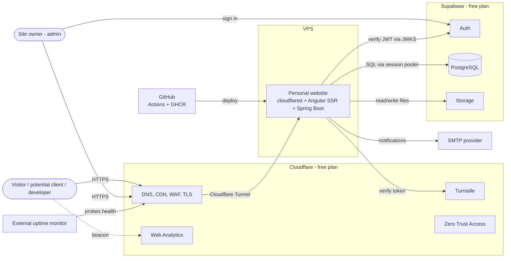
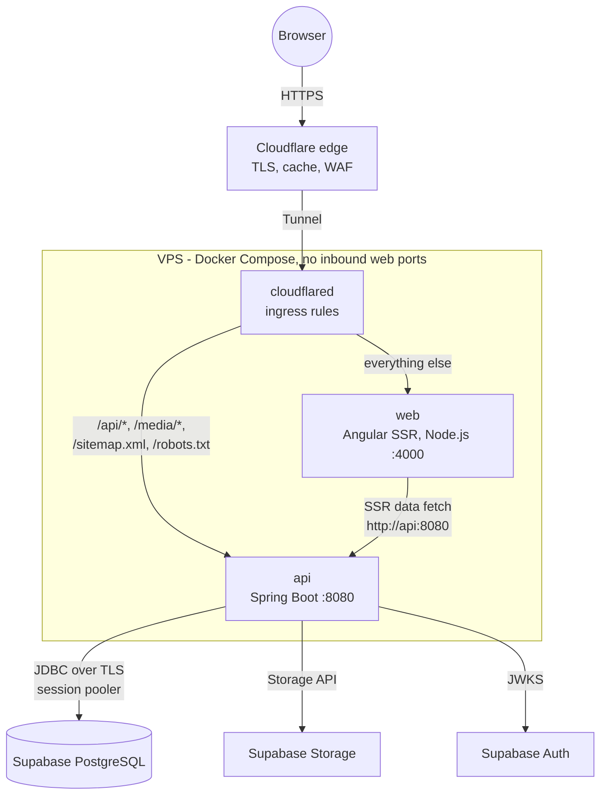
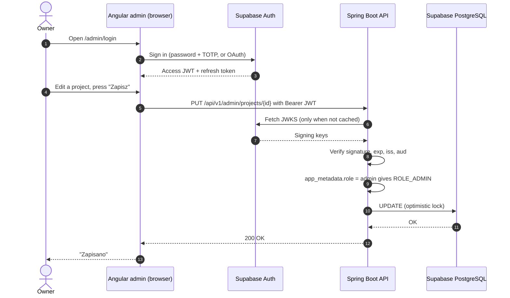
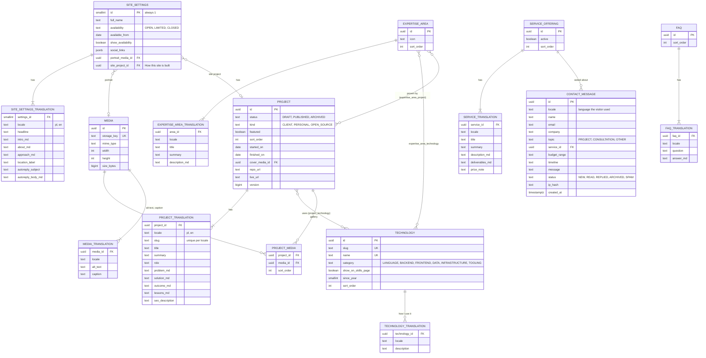
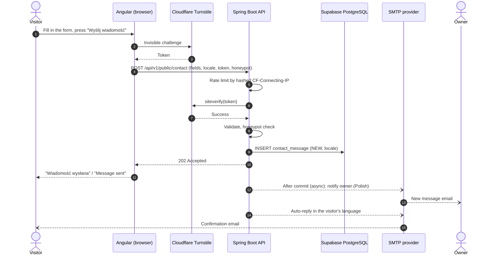
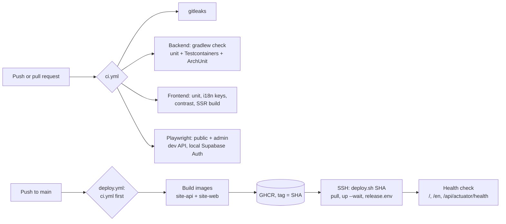

# Architecture

This document describes how the personal website is built, deployed and run. It covers the system context, the VPS setup behind Cloudflare Tunnel, how Supabase is used (Auth, PostgreSQL, Storage), the backend and frontend structure, internationalisation (Polish first, English optional), the data model, the API and the cross-cutting concerns.

Screen-level specifications (layout, data, states, technical hints) are in [`docs/screens/`](screens/). Coding conventions are in [`CONVENTIONS.md`](CONVENTIONS.md) and the build order in [`IMPLEMENTATION-PLAN.md`](IMPLEMENTATION-PLAN.md).

Diagrams: Mermaid sources are embedded below so they render on GitHub. Rendered SVGs and the formal UML views (PlantUML) are in [`docs/diagrams/`](diagrams/).

---

## 1. Goals and constraints

| Area | Decision driver |
|---|---|
| Purpose | Portfolio that advertises the owner's skillset through real projects; freelance services with a contact funnel. **Not** a job-seeking site: no CV, no recruiter-oriented features. |
| Languages | **Polish is the primary language.** English is available through a language switcher. |
| Skills fit | Java + Spring Boot + PostgreSQL on the backend, Angular on the frontend |
| Infrastructure | One VPS (2 vCPU, 8 GB RAM), own domain managed in Cloudflare |
| Budget | External services on free tiers (Supabase, Cloudflare, SMTP, GitHub) |
| Platform | Supabase for authentication, the PostgreSQL database and file storage |
| Content editing | The owner edits everything in a private admin panel; no redeploy for content changes |
| SEO | Public pages are server-rendered in both languages with correct `hreflang` links |

---

## 2. System context



| External system | Role | What happens if it is unavailable |
|---|---|---|
| Cloudflare | DNS, TLS, CDN cache, WAF, tunnel to the VPS, Turnstile, Web Analytics, Access for internal tools | The site is unreachable (Cloudflare is the entry point). |
| Supabase Auth | Owner sign-in, JWT issuance | Admin sign-in unavailable; public site unaffected. |
| Supabase PostgreSQL | All site content and contact messages | Pages that need fresh data fail; cached responses at Cloudflare and in the API cache keep serving for a while. |
| Supabase Storage | Images | New uploads fail; images already cached at Cloudflare keep loading. |
| SMTP provider | New-message notifications and auto-replies | Emails are retried; messages are stored and visible in the admin regardless. |
| GitHub Actions + GHCR | CI, image registry, deployments (free: 2,000 runner minutes a month for a private repository) | Deploys pause; the running site is unaffected. |
| External uptime monitor | Outside-in alerts | You lose alerting only. |

---

## 3. Deployment

### Topology

The site runs on your VPS as **three Docker containers** managed by Docker Compose (`infra/docker-compose.yml`): `api` (Spring Boot) and `web` (Angular SSR) from images built in CI and pulled from GHCR, plus the official `cloudflared` image. The database, auth and file storage are **not** on the VPS: they are Supabase services (see [§ 4](#4-supabase)), so the VPS keeps no data and can be rebuilt from the compose file and its `.env`.

No inbound ports are open for web traffic: `cloudflared` opens an outbound connection to Cloudflare, and Cloudflare forwards requests through it. The containers talk over the private Compose network only; none of them publishes a port on the host.



### Cloudflare Tunnel ingress

```yaml
# infra/cloudflared/config.yml (the tunnel id comes from TUNNEL_ID on the command line)
credentials-file: /etc/cloudflared/credentials.json

ingress:
  - path: ^/(api|media)/
    service: http://api:8080
  - path: ^/(sitemap\.xml|robots\.txt)$
    service: http://api:8080
  - service: http://web:4000           # www is redirected to the apex by a Cloudflare redirect rule first
```

The tunnel is locally managed, so these rules are versioned with the code: the hostnames routed to the tunnel (`cloudflared tunnel route dns`) decide which domains reach it, and the rules match by path only, which also lets a test hostname reuse the file. Its credentials JSON is a file on the VPS, never in the repository. The web build serves its fonts from `/fonts`, keeping `/media` for the API.

### No reverse proxy, no subdomains

The tunnel's ingress rules *are* the reverse proxy: they route by path on one hostname, top to bottom, to services on the Compose network. So there is no nginx (or Caddy, Traefik) on the VPS, no per-service host ports and no `api.` subdomain. One origin also keeps the browser and SSR setup simple: the frontend calls `/api` on its own origin (no CORS), and the transfer cache maps SSR's `http://api:8080` to it.

Add nginx only if you later need something the tunnel cannot do (per-path response rewriting, serving several unrelated sites from one container). Other projects on the same VPS can share the tunnel with their own hostnames and ingress rules.

### Cloudflare free plan: what this site uses

Everything below is available on the Free plan; nothing here needs a paid plan.

| Feature | Free plan | How this site uses it |
|---|---|---|
| Tunnel | Included; no Access seats are needed to publish a site | One tunnel with the path rules above |
| DNS, TLS, CDN cache, redirect and cache rules | Included (rule counts per zone are limited, well above the four rules used here) | `www` → apex redirect, media/static cache rules, admin cache bypass |
| WAF rate limiting | **1 rule**, counting by IP, 10 s period | Burst guard on `POST /api/v1/public/contact`; the hourly limit (5 per IP) is enforced by the API with Bucket4j |
| Bot Fight Mode, Free managed WAF ruleset | Included | On |
| Turnstile | Included | Contact form |
| Web Analytics | Included, cookieless | On |
| Zero Trust Access | Free for up to 50 users | Optional: SSH for deployments, internal tools |

### Cloudflare settings

| Setting | Value |
|---|---|
| SSL/TLS | Enable "Always Use HTTPS" and HSTS (tunnel traffic is encrypted end to end, so the origin needs no certificate) |
| Redirect rule | `www.mpospieszynski.pl/*` → `https://mpospieszynski.pl/$1` (301) |
| Cache rule | Cache `/media/*` and hashed static assets (`*.js`, `*.css`, fonts) with a long edge TTL |
| Cache rule | Bypass cache for `/api/v1/admin/*` and `/admin*` |
| Security | Bot Fight Mode on; the one free rate-limiting rule on `POST /api/v1/public/contact` (for example more than 3 requests in 10 s per IP → block for 10 s) |
| Web Analytics | Enabled for the domain (cookieless, no consent banner needed) |
| Zero Trust Access | Optional: protect any internal tool you add later, and SSH for deployments |

### Memory budget (8 GB)

| Container | Limit | Notes |
|---|---|---|
| cloudflared | 128 MB | |
| web (Node SSR) | 512 MB | `--max-old-space-size=384`; both languages served by one process |
| api (Spring Boot) | 1 GB | `-XX:MaxRAMPercentage=75`, virtual threads |
| **Total** | **~1.6 GB** | Plenty of room for other projects on the same VPS |

### Host hardening

Firewall that blocks all inbound traffic except SSH (or SSH only through Cloudflare Access, see CI/CD). SSH key-only login with root login disabled. Unattended security upgrades. Containers run as non-root users. Secrets live in a `.env` file (mode 600, owned by the `gha` user, the only account with Docker access) that is never committed.

---

## 4. Supabase

### What is used

| Feature | Used for |
|---|---|
| Auth | Owner sign-in (email + password with TOTP, or GitHub OAuth). Sign-ups disabled. |
| PostgreSQL | All site data, in a dedicated `site` schema managed by Flyway |
| Storage | A public `media` bucket for images |
| Data API (PostgREST) | **Not used.** The `site` schema is not exposed, so the publishable key cannot read site tables directly. |

Free-plan limits are far above what a portfolio needs (content will be a few megabytes; images well under 1 GB). Pick the Supabase region closest to your VPS: every database query crosses the network, so distance shows up directly in response times.

### Project setup

1. Create the project in the region closest to your VPS.
2. **Auth → Providers:** enable your sign-in method; **disable new user sign-ups**.
3. **Auth → Users:** create your user, then give it the admin role (only the service role can write `app_metadata`, so this cannot be self-assigned):
   ```sql
   update auth.users
   set raw_app_meta_data = raw_app_meta_data || '{"role":"admin"}'::jsonb
   where email = 'pospieszynski.michal@gmail.com';
   ```
4. **Auth → URL configuration:** add `https://mpospieszynski.pl/admin` and `http://localhost:4200/admin`.
5. **Auth → MFA:** enable TOTP and enrol your account.
6. **Database:** run `infra/supabase/roles.sql` once (SQL editor or psql). It creates the application role `site_app`, which owns the `site` schema so Flyway can migrate it, and the read-only `owner_ro` for your own client, both without a password. Then set the passwords with psql's `\password site_app` / `\password owner_ro`, which prompt and send only a hash, so no password is written in a file or the SQL editor's history.
7. **Settings → API → Exposed schemas:** leave `site` out.
8. **Storage:** create a public bucket `media` and a policy that lets only the admin write to it:
   ```sql
   create policy "admin manages media"
   on storage.objects for all to authenticated
   using      (bucket_id = 'media' and (auth.jwt() -> 'app_metadata' ->> 'role') = 'admin')
   with check (bucket_id = 'media' and (auth.jwt() -> 'app_metadata' ->> 'role') = 'admin');
   ```

### Access from your computer

The database lives in Supabase, outside the VPS, so you can reach it from your own computer with any PostgreSQL client (psql, DBeaver, IntelliJ). Nothing on the VPS has to be opened for that.

1. Take the **session pooler** connection string from the dashboard's Connect panel (it works over IPv4; the direct connection needs IPv6). TLS is required (`sslmode=require`).
2. Sign in with a personal role, not the application's `site_app` role, so the application's password never sits on your laptop. For everyday inspection a read-only role is enough (`infra/supabase/roles.sql` creates both roles; passwords are set with psql's `\password`):
   ```sql
   create role owner_ro login password '<strong-password>';
   grant usage on schema site to owner_ro;
   grant select on all tables in schema site to owner_ro;
   alter default privileges for role site_app in schema site grant select on tables to owner_ro;
   ```
   Content changes go through the admin panel (validation, cache eviction); schema changes go through Flyway migrations in the repository, never by hand.
3. Optionally restrict who may connect: **Database → Network restrictions** can allow only your IP and the VPS's IP.
4. To try migrations or run the backend locally against real infrastructure, use a second Supabase project as staging (the free plan allows two) and point the `dev` profile's datasource at it with environment variables.

Keep these connection details in your password manager or the client's credential store, not in the repository.

### Connecting from Spring Boot

Use the **session pooler** connection string from the dashboard's Connect panel. It works over IPv4, unlike the direct connection, and it supports the prepared statements Hibernate and Flyway rely on. Avoid the transaction pooler for this application.

```yaml
spring:
  datasource:
    url: ${SUPABASE_DB_URL}            # jdbc:postgresql://<pooler-host>:5432/postgres?sslmode=require
    username: ${SUPABASE_DB_USER}      # e.g. site_app.<project-ref>
    password: ${SUPABASE_DB_PASSWORD}
    hikari:
      maximum-pool-size: 5
      minimum-idle: 1
  jpa:
    open-in-view: false
    properties:
      hibernate.default_schema: site
  flyway:
    schemas: site
    default-schema: site
```

Flyway owns only the `site` schema. Supabase's own schemas (`auth`, `storage` and others) are never touched by migrations.

Optional: Supabase pauses free projects after a week without activity. Normal traffic counts as activity. A daily `@Scheduled` query in the API is a one-line safeguard for quiet weeks.

### Media through your own domain

Files are stored in Supabase Storage, but the site links to them as `https://mpospieszynski.pl/media/<key>`. A small `MediaController` in the API streams the object from Storage and sets `Cache-Control: public, max-age=31536000, immutable`. Cloudflare caches the response at the edge, so:

- URLs use your domain and survive a change of storage provider.
- Repeat image requests are served by Cloudflare, which keeps Supabase egress low.
- The Content Security Policy only needs `img-src 'self'`.

Uploads go through the API (`POST /api/v1/admin/media`). The API validates type and size, then writes to Storage using **the admin's own JWT** forwarded with the publishable key. The Storage policy above authorises the write, so no service-role key exists anywhere in the system.

---

## 5. Backend (Spring Boot)

### Stack

| Concern | Choice |
|---|---|
| Runtime | Java 21 (Gradle toolchain `JavaLanguageVersion.of(21)`, Java 21 JRE image), Spring Boot (current stable line) |
| Build | Gradle (Kotlin DSL, wrapper); layered `bootJar` on a slim JRE image |
| Web | Spring Web MVC + virtual threads |
| Persistence | Spring Data JPA (Hibernate), Flyway, schema `site` |
| Security | Spring Security OAuth2 Resource Server validating Supabase JWTs |
| Storage | `MediaStorage` interface with a `SupabaseStorage` implementation (Spring `RestClient`) |
| i18n | `Locale` resolved from the `lang` query parameter; Spring `MessageSource` for emails |
| Validation | Jakarta Bean Validation, messages in Polish and English |
| API docs | springdoc-openapi; the spec generates the Angular client |
| Caching | Caffeine for public reads, keyed by language, evicted on admin writes |
| Rate limiting | Bucket4j on the contact endpoint, keyed by `CF-Connecting-IP` |
| Mail | Spring Mail over SMTP; templates per language |
| Observability | Actuator health, Micrometer, JSON logs |
| Testing | JUnit 5, Testcontainers (PostgreSQL), Spring Security test, ArchUnit |

### Package structure: modular monolith, package by feature

```
pl.mpospieszynski.site
├── SiteApplication.java
├── shared/
│   ├── security/      SecurityConfig, SupabaseJwtConverter
│   ├── web/           ProblemDetail handler, ServerTimingFilter, ClientIpResolver (CF-Connecting-IP)
│   ├── i18n/          SiteLocale enum (PL, EN), LocaleResolver, translation fallback helper
│   └── storage/       MediaStorage, SupabaseStorage, MediaController
├── profile/           site settings: headline, intro, about, approach, availability
├── projects/          projects, translations, technologies, gallery
├── skills/            technologies, expertise areas, evidence links to projects
├── services/          offerings, FAQ
├── contact/           contact form, inbox, notifications, spam checks
└── seo/               sitemap.xml (with hreflang alternates), robots.txt
```

Each feature has `api/` (controllers, DTOs), `domain/` (entities, services) and `infra/` (repositories, adapters). Features depend on `shared` but not on each other's internals; ArchUnit tests enforce that.

### Request flow

```
Request → ClientIpResolver → ServerTimingFilter → SecurityFilterChain (JWT for /admin)
        → Controller (validation, lang) → Service (transaction) → Repository → Supabase PostgreSQL
        ← localised DTO ← ProblemDetail on errors (RFC 9457, localised detail)
```

`ServerTimingFilter` adds `Server-Timing: app;dur=…, db;dur=…`. It is for diagnostics (browser dev tools, logs); the home page no longer shows it since the redesign.

### Security configuration

```yaml
spring:
  security:
    oauth2:
      resourceserver:
        jwt:
          jwk-set-uri: ${SUPABASE_URL}/auth/v1/.well-known/jwks.json
site:
  security:
    jwt-issuer: ${SUPABASE_URL}/auth/v1
    jwt-audience: authenticated
```

```java
@Configuration
@EnableMethodSecurity
class SecurityConfig {

    @Bean
    SecurityFilterChain api(HttpSecurity http, SupabaseJwtConverter converter) throws Exception {
        return http
            .csrf(AbstractHttpConfigurer::disable)          // stateless bearer tokens, no cookies
            .sessionManagement(s -> s.sessionCreationPolicy(SessionCreationPolicy.STATELESS))
            .authorizeHttpRequests(auth -> auth
                .requestMatchers(HttpMethod.GET, "/api/v1/public/**", "/media/**",
                                 "/sitemap.xml", "/robots.txt").permitAll()
                .requestMatchers(HttpMethod.POST, "/api/v1/public/contact").permitAll()
                .requestMatchers("/api/actuator/health/**").permitAll()
                .requestMatchers("/api/v1/admin/**").hasRole("ADMIN")
                .anyRequest().denyAll())
            .oauth2ResourceServer(o -> o.jwt(jwt -> jwt.jwtAuthenticationConverter(converter)))
            .build();
    }

    @Bean
    JwtDecoder jwtDecoder(OAuth2ResourceServerProperties props, SiteSecurityProperties site) {
        NimbusJwtDecoder decoder = NimbusJwtDecoder.withJwkSetUri(props.getJwt().getJwkSetUri())
            .jwsAlgorithms(algs -> { algs.add(SignatureAlgorithm.ES256); algs.add(SignatureAlgorithm.RS256); })
            .build();
        decoder.setJwtValidator(new DelegatingOAuth2TokenValidator<>(
            JwtValidators.createDefaultWithIssuer(site.jwtIssuer()),
            new JwtClaimValidator<List<String>>("aud", aud -> aud != null && aud.contains(site.jwtAudience()))));
        return decoder;
    }
}
```

```java
@Component
class SupabaseJwtConverter implements Converter<Jwt, AbstractAuthenticationToken> {
    @Override
    public AbstractAuthenticationToken convert(Jwt jwt) {
        Map<String, Object> appMeta = jwt.getClaimAsMap("app_metadata");
        boolean admin = appMeta != null && "admin".equals(appMeta.get("role"));
        var authorities = admin ? List.of(new SimpleGrantedAuthority("ROLE_ADMIN")) : List.<GrantedAuthority>of();
        return new JwtAuthenticationToken(jwt, authorities, jwt.getClaimAsString("email"));
    }
}
```

> Newer Supabase projects sign tokens with asymmetric keys published at the JWKS URL (the setup shown). If your project still uses the legacy shared HS256 secret, build the decoder with `NimbusJwtDecoder.withSecretKey(...)` instead. The project's JWT settings show which mode is active.

Set `management.endpoints.web.base-path=/api/actuator` and expose only `health`, so the tunnel's `/api/` rule covers it.

---

## 6. Frontend (Angular)

### Stack

| Concern | Choice |
|---|---|
| Framework | Angular (current major), standalone components, signals |
| Rendering | Angular SSR with hydration for all public routes in both languages; admin is client-side only |
| i18n | **Transloco** (runtime translations, one build) with the MessageFormat plugin for Polish plural forms |
| Locale data | `registerLocaleData(localePl)` and English for dates and numbers |
| Styling | SCSS + CSS custom properties from the design tokens; Angular CDK for overlays and a11y |
| Admin UI | Angular Material themed with the same tokens; admin interface in Polish |
| API client | Generated from the backend's OpenAPI spec |
| Auth | `@supabase/supabase-js`, lazy-loaded only in the admin bundle |
| Fonts | Self-hosted via `@fontsource`, `latin-ext` subset for Polish characters |
| Analytics | PostHog (`posthog-js`, lazy-loaded after the cookie banner's answer) behind `ConsentService`/`AnalyticsService`, events through the SSR server's `/ingest` proxy; off without `POSTHOG_KEY` ([ANALYTICS.md](ANALYTICS.md)) |
| Testing | Vitest/Jest, Playwright (including both languages) |

### Routes

Polish lives at the root; English lives under `/en` with English slugs. Both trees point to the same components; a `LanguageService` reads the language from the URL.

| Page | Polish (primary) | English |
|---|---|---|
| Home | `/` | `/en` |
| Projects | `/projekty` | `/en/projects` |
| Case study | `/projekty/:slug` | `/en/projects/:slug` |
| Skills | `/umiejetnosci` | `/en/skills` |
| Services | `/uslugi` | `/en/services` |
| About | `/o-mnie` | `/en/about` |
| Contact | `/kontakt` | `/en/contact` |
| Privacy | `/polityka-prywatnosci` | `/en/privacy` |
| Admin | `/admin/**` (Polish UI, no locale prefix) | – |

```
src/app
├── core/          API_BASE_URL token, LanguageService, route map, SeoService (hreflang), interceptors
├── shared/        UI primitives built on design tokens, LanguageSwitcher
├── features/
│   ├── home/  projects/  skills/  services/  about/  contact/  legal/  not-found/
│   └── admin/     lazy: login, dashboard, editors with PL/EN tabs, inbox, settings
├── api/           generated client (do not edit)
└── i18n/          pl.json, en.json (UI strings)
```

During SSR, `HttpClient` calls the API on the Docker network (`http://api:8080`); in the browser it uses relative `/api`. Translation files are bundled with a static loader so SSR never fetches them over HTTP.

---

## 7. Internationalisation

### Principles

1. **Polish is the default and the source of truth.** Every piece of content must exist in Polish. English is optional per item.
2. **The URL decides the language.** There is no automatic redirect based on the browser language or the visitor's country, because redirects confuse crawlers and frustrate people who chose a language on purpose. The one exception follows the visitor's own choice: after they pick English (the language pill or the language hint, stored as `localStorage.lang`), the bare home address `/` opens `/en` (a script in `index.html`, before the first paint). Deep links are never redirected, and crawlers, which store nothing, always get Polish at `/`.
3. **Two kinds of text:**
   - **UI strings** (navigation, labels, buttons, errors) are kept in `pl.json` and `en.json` in the repo. They are always complete in both languages, and CI fails if a key is missing.
   - **Content** (projects, skills, services, about texts) lives in the database in translation tables and is edited in the admin.

### Fallback rules for missing English content

| Content | Rule on English pages |
|---|---|
| Project without English translation | Listed with a "Polish only" label. Its card links to the Polish case study. No `/en/projects/:slug` page exists, so there is no duplicate content. |
| Technology description, expertise area, service, FAQ, about text | Polish text is shown, wrapped in an element with `lang="pl"` so screen readers pronounce it correctly. The admin dashboard lists what is missing. |

### Language switcher

The switcher sits in the header and links to the **equivalent page** in the other language, not to the home page.

- Static pages map through a route table (`projects` ↔ `projekty`).
- Case studies use the `translations` map from the API (`{ "pl": "system-zamowien", "en": "order-processing-api" }`).
- If no translation exists, the switcher goes to the English projects list with a short note.
- On Polish pages, visitors whose browser prefers English see a dismissible line: "This site is also available in English." The choice is remembered in `localStorage`, and nothing else changes automatically.

### SEO for two languages

- `<html lang="pl">` or `lang="en"`, set during SSR.
- `<link rel="alternate" hreflang="pl" …>`, `hreflang="en"` (only when the English page exists) and `hreflang="x-default"` pointing to Polish.
- `og:locale` `pl_PL` and `og:locale:alternate` `en_GB` (or `en_US`, as you prefer).
- `sitemap.xml` lists both versions with `xhtml:link` alternates.

### Polish-specific details

- **Plurals:** Polish has more plural forms than English (1 projekt, 2 projekty, 5 projektów). Use ICU MessageFormat:
  ```json
  "projects.count": "{count, plural, one {# projekt} few {# projekty} many {# projektów} other {# projektu}}"
  ```
- **Slugs:** generate them with a Polish transliteration map. Unicode decomposition does not turn `ł` into `l`, so `ł → l` must be explicit, alongside `ą ć ę ń ó ś ź ż`.
- **Dates:** `październik 2026` in Polish (nominative month in "month year" ranges), `October 2026` in English. Use Angular's `DatePipe` with `LLLL yyyy` for stand-alone month names.
- **Text length:** Polish strings are often 20–30% longer. The navigation and buttons are designed for the Polish length first.
- **Hyphenation:** `hyphens: auto` with the correct `lang` attribute improves long Polish words in narrow columns.

### Backend side

- Public endpoints take `?lang=pl|en` (default `pl`). An explicit parameter works with caching better than `Accept-Language`.
- Detail responses include `lang` (the language actually returned) and `translations` (slugs per language), which drive the switcher and `hreflang`.
- Contact messages store the visitor's `locale`, so the auto-reply goes out in that language.
- Validation messages come from `ValidationMessages_pl.properties` and `ValidationMessages_en.properties`.

---

## 8. Authentication flow



---

## 9. Data model

Language-neutral data sits in base tables; translatable text sits in `*_translation` tables keyed by `(id, locale)`. `locale` is `'pl'` or `'en'`; a `pl` row is required for every translatable record.

The skillset is modelled so that **every skill is backed by evidence**: technologies are linked to the projects that use them, and expertise areas (e.g. "API design", "Database performance") group technologies and point to the projects that demonstrate them.



Notes:

- Primary key of each translation table is `(parent_id, locale)`, with a check constraint `locale in ('pl','en')`.
- `project_translation` has a unique index on `(locale, slug)`.
- Technology names are not translated (Java is Java); their descriptions ("how I use it") and category labels are. Category labels live in the UI translation files.
- "Used in N projects" on the skills page is computed from `project_technology` over published projects, so it can never drift from the portfolio.
- `ip_hash` is a salted hash, used only for rate limiting and spam analysis.
- A scheduled job deletes contact messages after the retention period stated in the privacy policy (e.g. 12 months).

---

## 10. API

Versioned under `/api/v1`. Public endpoints take `?lang=pl|en` (default `pl`). Errors use RFC 9457 `ProblemDetail` with a localised `detail`. Request/response shapes per screen are listed in the screen specs under [`docs/screens/`](screens/).

### Public

| Method | Path | Purpose |
|---|---|---|
| GET | `/api/v1/public/profile?lang=` | Name, headline, intro, about, approach, availability, socials |
| GET | `/api/v1/public/projects?lang=&kind=&tech=&featured=` | Published projects; each item has `lang` and `translations` |
| GET | `/api/v1/public/projects/{slug}?lang=` | Case study by slug in that language |
| GET | `/api/v1/public/technologies?lang=` | Technologies used by published projects (filters) |
| GET | `/api/v1/public/skills?lang=` | Expertise areas with their technologies and evidence projects, plus technologies grouped by category with project counts |
| GET | `/api/v1/public/services?lang=` | Active offerings + FAQ |
| POST | `/api/v1/public/contact` | Message incl. `locale`, Turnstile token, honeypot |
| GET | `/media/{key}` | File from Storage, cached at Cloudflare |
| GET | `/sitemap.xml`, `/robots.txt` | SEO |

Public GETs return `ETag` and `Cache-Control: public, max-age=60, stale-while-revalidate=600`.

Example detail response:

```json
{
  "lang": "pl",
  "slug": "system-zamowien",
  "translations": { "pl": "system-zamowien", "en": "order-processing-api" },
  "title": "System przetwarzania zamówień",
  "summary": "Skrócenie nocnego przetwarzania z 4 godzin do 25 minut.",
  "kind": "CLIENT",
  "technologies": [{ "slug": "spring-boot", "name": "Spring Boot" }]
}
```

### Admin

Admin endpoints return and accept **all translations at once**, so editors can show PL and EN side by side.

| Method | Path | Purpose |
|---|---|---|
| GET/PUT | `/api/v1/admin/profile` | Settings with `translations: { pl: {...}, en: {...} }` |
| GET/POST | `/api/v1/admin/projects` | List (incl. drafts, translation status) / create |
| GET/PUT/DELETE | `/api/v1/admin/projects/{id}` | Edit / delete |
| POST | `/api/v1/admin/projects/{id}/publish`, `/unpublish` | Publish state |
| PUT | `/api/v1/admin/projects/order` | Reorder |
| CRUD | `/api/v1/admin/technologies` | Technologies with translations |
| CRUD | `/api/v1/admin/expertise-areas` (+ `/order`) | Expertise areas with technologies and projects |
| CRUD | `/api/v1/admin/services`, `/api/v1/admin/faq` (+ `/order`) | Services and FAQ |
| GET/POST/PUT/DELETE | `/api/v1/admin/media` | List, upload to Supabase Storage, edit alt text, delete when unused |
| GET/PATCH | `/api/v1/admin/messages` | Inbox and status changes |
| GET | `/api/v1/admin/dashboard` | New messages, drafts, missing English translations |

---

## 11. Contact form flow



Mail is sent from a `@TransactionalEventListener(phase = AFTER_COMMIT)` running `@Async`. A slow or failing mail provider never blocks or loses a message.

---

## 12. Cross-cutting concerns

### Security

- **Headers:** HSTS from Cloudflare; CSP, `X-Content-Type-Options`, `Referrer-Policy` and `Permissions-Policy` set by the Angular SSR server (`frontend/src/server-security.ts`) and the API (`SecurityConfig`). The page CSP uses a per-request script nonce (no `'unsafe-inline'` or `'unsafe-eval'` for scripts; ICU plurals use `Intl.PluralRules` instead of MessageFormat's generated code) and allows `self`, Supabase Auth (`connect-src`, admin only), Turnstile (contact pages only) and Cloudflare Web Analytics; styles allow inline (Angular component styles). The API answers with `default-src 'none'`.
- **Client IP:** taken from `CF-Connecting-IP`. This is trustworthy because the API is reachable only through the tunnel.
- **Input:** Bean Validation on every DTO, size limits on Markdown and uploads, server-side Markdown sanitising.
- **Uploads:** content-type sniffing, size limits, random storage keys.
- **Supabase:** sign-ups disabled, MFA on, `site` schema not exposed via the Data API, Storage writes limited to the admin by policy, no service-role key used anywhere.
- **Dependencies:** Renovate or Dependabot for Gradle, npm and Docker images.

### Performance

- Cloudflare caches static assets and `/media/*` at the edge.
- The API caches public reads in Caffeine per language, which hides the network distance to Supabase on most requests.
- Responsive WebP images with `srcset`, lazy-loaded below the fold.
- Targets: LCP under 2 s on mobile 4G, CLS under 0.05, Lighthouse 95+.

### Observability

- Actuator health at `/api/actuator/health` (liveness and readiness).
- JSON logs to stdout (`docker compose logs`).
- External free uptime monitor probing the home page and the health endpoint in both languages (`/` and `/en`).
- Cloudflare Web Analytics for traffic, PostHog for product analytics, heatmaps and recordings (with consent, [ANALYTICS.md](ANALYTICS.md)), the Supabase dashboard for database and auth usage.

### Privacy (GDPR)

- Self-hosted fonts, no third-party requests on public pages except Turnstile on the contact page; PostHog goes through the site's own `/ingest` proxy.
- A cookie banner asks before anything is stored: cookies, heatmaps and recordings only after **Accept**; after **Reject** (or a Global Privacy Control signal) only cookieless counting; before an answer nothing is loaded ([ANALYTICS.md](ANALYTICS.md) §2).
- The privacy policy (`/polityka-prywatnosci`, `/en/privacy`) names the processors: Supabase (database, auth, storage), Cloudflare (delivery, bot protection, analytics), PostHog (usage analytics, EU hosting) and the SMTP provider. It also states what the form stores, why, for how long, and how to request deletion.
- An EU Supabase region keeps the data inside the EU.

---

## 13. CI/CD



- Workflows: `.github/workflows/ci.yml` (every push to other branches and every pull request; also called by the deploy) and `.github/workflows/deploy.yml` (push to `main`, or by hand with a `tag` input to roll back without rebuilding). On the VPS, `infra/deploy.sh <sha>` is the one way to switch releases: it writes `TAG` to `release.env`, waits for the health checks with `docker compose up --wait`, puts the previous release back if they fail, and remembers it for `deploy.sh --previous`.
- Images are tagged with the git SHA; rollback is redeploying the previous tag. Flyway migrations stay backward compatible with the previous app version to make that safe.
- Migrations run against Supabase when the API starts. A separate Supabase project (the free plan allows two) can serve as staging for testing migrations first.
- **SSH:** the workflow connects directly (port 22 or `DEPLOY_PORT`), key-only, to a dedicated `gha` user, and verifies the host key from `DEPLOY_KNOWN_HOSTS`. SSH through Cloudflare Access with a service token, so the VPS has no open inbound ports at all, is a possible later change (not implemented).
- **Why GitHub Actions and not Codemagic:** Codemagic's free plan gives 500 minutes a month on macOS machines only; Linux machines are billed per minute. This pipeline needs Linux with Docker (Testcontainers in `./gradlew check`, building the `linux/amd64` images, the Playwright stack), which the macOS build machines cannot provide. GitHub-hosted Ubuntu runners have Docker preinstalled, and the free plan's 2,000 minutes a month for a private repository (unlimited for a public one) cover several hundred runs of this pipeline.

### Secrets

No credential is ever written into the repository, an image or a workflow file. Secrets live in exactly two places, and each holds only what its side needs:

| Where | What | Who sets it |
|---|---|---|
| **VPS:** `/opt/site/.env`, owned by the `gha` user (the only account with Docker access, which is root-equivalent anyway), mode `600` | Every runtime secret: Supabase DB password, Turnstile secret, SMTP password, `IP_HASH_SALT`; the tunnel credentials JSON next to it (`cloudflared/credentials.json`, mode `400`) | You, once, over SSH (from `infra/.env.example`); changed by hand when a secret rotates |
| **GitHub:** repository → Settings → Environments → `production` → secrets | Only what a deployment needs: `DEPLOY_SSH_KEY` (private key of the VPS `gha` user), `DEPLOY_HOST`, `DEPLOY_USER`, `DEPLOY_KNOWN_HOSTS`; plus the non-secret variables `SITE_URL` and `DEPLOY_PORT` (optional) | You, in the GitHub UI |

- Images are pushed to GHCR with the workflow's short-lived `GITHUB_TOKEN` (`packages: write`), so no registry password is stored anywhere. The VPS pulls with a fine-grained token limited to reading packages, stored once by `docker login ghcr.io` in the `gha` user's Docker config, or with no token at all if the packages are public.
- CI tests use no secrets: Testcontainers and the dev compose for the database, a local Supabase Auth with a signing key generated per run and seed test users, Cloudflare's published Turnstile test keys, Mailpit.
- The deploy job sends only the image tag and the stack files of that commit (`docker-compose.yml`, `cloudflared/config.yml`, `deploy.sh`) to the VPS; it never reads or writes `.env` or the tunnel credentials.
- The `production` environment can require your approval before a deployment runs, and environment secrets are never exposed to pull-request builds from forks.
- CI runs a secret scanner (gitleaks) on every push, `.env` is in `.gitignore`, and GitHub secret scanning with push protection is enabled for the repository.
- Public values are not secrets: the Turnstile site key and the Supabase publishable key reach the browser by design. They are still kept in the same `.env`, so every environment value has one home.

---

## 14. Architecture decisions

| ID | Decision | Reasoning |
|---|---|---|
| ADR-001 | Supabase for **Auth, PostgreSQL and Storage** | Managed database and files with no operations work on the VPS; the free plan covers this site comfortably. |
| ADR-002 | Data in a dedicated **`site` schema**, not exposed via the Data API | All access goes through Spring, where validation and business rules live; Flyway owns only this schema. |
| ADR-003 | **Cloudflare Tunnel** instead of a reverse proxy | Domain already on Cloudflare; no open web ports, no certificate management, edge caching included. |
| ADR-004 | **Angular SSR** for public pages | Search engines and link previews need real HTML in both languages. |
| ADR-005 | **Transloco** (runtime i18n) instead of `@angular/localize` | One build and one SSR process serve both languages; localised route slugs and content fallbacks are straightforward. `@angular/localize` would need a build per language. |
| ADR-006 | **Translation tables** in the database | Clean schema, Polish required and English optional per row, easy to add a third language. |
| ADR-007 | **Media served through `/media/*` on your domain** | Stable URLs, edge caching, low Supabase egress, simple CSP. |
| ADR-008 | **Modular monolith** | One deployable for one developer; feature packages keep boundaries clear. |
| ADR-009 | **GitHub Actions + GHCR** for CI/CD, not Codemagic | Free Linux runners with Docker (Testcontainers, image builds); Codemagic's free plan is macOS-only, which cannot run Docker. Registry authentication needs no stored password (`GITHUB_TOKEN`). |
| ADR-010 | **Runtime secrets only on the VPS**, deployment secrets only in a GitHub environment | Nothing secret in the repository or images; CI never sees production credentials, so a leaked CI log cannot expose them. |
| ADR-011 | **Cloudflare Web Analytics** | Free, cookieless, no extra container. |
| ADR-012 | **Skills backed by project evidence** | Technologies and expertise areas link to the projects that use them, so the skillset is demonstrated rather than claimed. |
| ADR-013 | **No CV or job-seeking features** | The site advertises skills and services; it is not an application form. |
| ADR-014 | **PostHog Cloud EU with a consent banner**, next to Cloudflare Web Analytics | Heatmaps, recordings and funnels need consent; PostHog does both modes in one tool (`cookieless_mode: 'on_reject'`), has a free tier and EU hosting. Loaded only after an answer, through a first-party proxy. Details: [ANALYTICS.md](ANALYTICS.md). |

---

## 15. Open questions

- English variant for `og:locale` and spelling: British or American?
- Admin sign-in method: email + password with TOTP, or GitHub OAuth?
- Should freelance prices be shown publicly on the services page or quoted individually?
