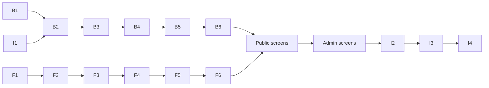

# Implementation plan

The build order, from foundations to screens. Each task has an ID you can reference in a prompt ("Do task B2 from `docs/IMPLEMENTATION-PLAN.md`"). Screen tasks point to their spec in [`docs/screens/`](screens/). All tasks follow [`CONVENTIONS.md`](CONVENTIONS.md).

---

## Phase 1 – Backend foundation

### B1. Backend skeleton
- Gradle project `backend/`, group `pl.mpospieszynski`, artifact `site-api`, Java 21.
- Dependencies: Web, Validation, Data JPA, PostgreSQL driver, Flyway, Security, OAuth2 Resource Server, Actuator, Cache + Caffeine, Mail, springdoc-openapi, Bucket4j, datasource-proxy, Testcontainers, ArchUnit.
- Profiles: `dev` (local PostgreSQL, Mailpit, sample data), `prod` (Supabase).
- Virtual threads on; `open-in-view: false`; actuator base path `/api/actuator`, only `health` exposed.
- **Done when:** `./gradlew check` passes with an empty context test and an ArchUnit test for package rules.

### B2. Database schema V1
- `V1__init.sql`: schema `site` with every table from [ARCHITECTURE § 9](ARCHITECTURE.md#9-data-model), constraints, indexes (`project_translation(locale, slug)` unique, foreign keys, `sort_order` indexes).
- `V2__technologies_seed.sql`: common technologies with categories.
- Dev-only sample content (Flyway location `db/dev`): settings, 4 projects (one Polish only), expertise areas, services, FAQ, in both languages.
- **Done when:** a Testcontainers test runs all migrations and reads the sample data.

### B3. Security with Supabase
- `SecurityConfig`, `JwtDecoder` (JWKS, issuer, audience), `SupabaseJwtConverter` as in [ARCHITECTURE § 5](ARCHITECTURE.md#security-configuration).
- Test helper that issues JWTs signed by a test key (`spring-security-test` `jwt()` post-processor is enough for MVC tests).
- **Done when:** tests prove anonymous → 401 on admin, non-admin → 403, admin → 200, public GETs open.

### B4. Shared web infrastructure
- `SiteLocale` enum + converter for `?lang=`; `Translations.pick()` and `Localized<T>`.
- `ProblemDetail` advice with localised messages; exceptions from the conventions.
- `ClientIpResolver` (`CF-Connecting-IP`, fallback to remote address in dev) and salted hashing.
- `ServerTimingFilter`: measures app time and adds DB time collected by a datasource-proxy listener into a request-scoped holder. Adds `cache;desc=hit` when a cached response was served.
- `ContentChangedEvent` and cache eviction listener.
- **Done when:** a test endpoint shows `Server-Timing` with `app` and `db` entries.

### B5. Media storage
- `MediaStorage` interface; `SupabaseStorage` using `RestClient` against `${SUPABASE_URL}/storage/v1`, forwarding the admin's JWT plus the publishable key.
- `LocalDiskStorage` for the `dev` profile.
- `MediaController` `GET /media/{key}` streaming the object with `Cache-Control: public, max-age=31536000, immutable` and the correct content type.
- **Done when:** upload/read/delete work against the local implementation in tests; the Supabase implementation is covered by a test with a mocked HTTP server.

### B6. OpenAPI
- springdoc configured with operationIds; spec at `/api/v3/api-docs`.
- **Done when:** the spec builds and contains the security scheme for admin endpoints.

---

## Phase 2 – Frontend foundation

### F1. Angular skeleton with SSR
- `ng new frontend --ssr --style=scss --routing`, strict mode, standalone.
- Server routes config: public routes `RenderMode.Server`, `admin/**` `RenderMode.Client`.
- `API_BASE_URL` token: `http://api:8080` on the server (env `API_INTERNAL_URL`), `''` in the browser. HTTP transfer cache enabled.
- Dev proxy `/api` and `/media` → `localhost:8080`.
- **Done when:** `npm run build && npm run serve:ssr` serves a page rendered on the server.

### F2. Design tokens and global styles
- `src/styles/tokens.scss` with every token from [UI-UX-DESIGN § 6](UI-UX-DESIGN.md#6-design-tokens) and [DIRECTION.md](../DIRECTION.md): dark (walnut) values on `:root`, light variant under `[data-theme="light"]`. No `prefers-color-scheme` switching; dark is the default for everyone.
- `_breakpoints.scss` mixin `bp()`, `_typography.scss` (the five `--step-*` sizes, prose styles), reset.
- Fonts via `@fontsource-variable/bodoni-moda` and `@fontsource-variable/jost`, `latin-ext` subsets. No monospace font; tabular figures for aligned numbers.
- Shared primitives for the direction: `ui-stripe`, the split layout with a sticky `ui-stage` (see F6).
- Inline script in `index.html` that sets `data-theme="light"` before first paint when `localStorage.theme === 'light'`.
- **Done when:** a style-guide route in dev shows all tokens, type sizes, the stripe and both themes, and every text pair in §6 meets its listed contrast.

### F3. i18n and localised routing
- Transloco with static loader for `pl.json` and `en.json`, MessageFormat plugin, `registerLocaleData(localePl)`.
- `core/i18n/route-table.ts` (route keys and slugs per language) and `buildLocalizedRoutes()`.
- `LanguageService`: `lang` signal from route data, `path(routeKey, params, lang?)`, `switchUrl()` for the switcher, persistence of the hint dismissal.
- `localizedPath` pipe; `npm run i18n:check` script comparing keys.
- **Done when:** `/` and `/en` render the same placeholder page in both languages with the right `<html lang>`.

### F4. API client
- `openapi-generator-cli` (`typescript-angular`) into `src/app/api`, script `npm run api:generate`.
- Interceptor for `ProblemDetail` errors (maps to a typed `ApiError`).
- **Done when:** a resolver can call a generated method and SSR transfers the response to the browser without a second request.

### F5. SEO service
- `SeoService.update()` as in [CONVENTIONS § 3](CONVENTIONS.md#seo), plus JSON-LD helper (`Person` on Home, `CreativeWork` on case studies, `Service` on Services).
- **Done when:** unit tests check tags for a page with and without an English alternate.

### F6. Shared UI components
- All components in [UI-UX-DESIGN § 7](UI-UX-DESIGN.md#7-shared-components) except the trace panel.
- **Done when:** each is shown in the dev style-guide route with its variants and passes axe.

---

## Phase 3 – Public screens

| ID | Spec | Notes |
|---|---|---|
| S1 | [App shell](screens/public/01-app-shell.md) | Header, switcher, footer, theme, language hint |
| S2 | [Projects list](screens/public/03-projects-list.md) | First real data screen |
| S3 | [Project detail](screens/public/04-project-detail.md) | Markdown, gallery, prev/next |
| S4 | [Home](screens/public/02-home.md) | Needs projects and skills endpoints; trace panel |
| S5 | [Skills](screens/public/05-skills.md) | |
| S6 | [Services](screens/public/06-services.md) | |
| S7 | [About](screens/public/07-about.md) | |
| S8 | [Contact](screens/public/08-contact.md) | Turnstile, mail, rate limit |
| S9 | [Privacy](screens/public/09-privacy.md) | |
| S10 | [Not found](screens/public/10-not-found.md) | Can be done right after S1 |

## Phase 4 – Admin screens

| ID | Spec | Notes |
|---|---|---|
| A1 | [Admin shell](screens/admin/01-admin-shell.md) | Guard, interceptor, layout |
| A2 | [Login](screens/admin/02-login.md) | Supabase, MFA |
| A3 | [Media](screens/admin/09-media.md) | Needed by editors (media picker) |
| A4 | [Projects list](screens/admin/05-projects-list.md) | |
| A5 | [Project editor](screens/admin/06-project-editor.md) | Largest screen |
| A6 | [Skills](screens/admin/07-skills.md) | |
| A7 | [Services and FAQ](screens/admin/08-services-faq.md) | |
| A8 | [Settings](screens/admin/10-settings.md) | |
| A9 | [Messages](screens/admin/04-messages.md) | |
| A10 | [Dashboard](screens/admin/03-dashboard.md) | Last: aggregates the others |

### R1. Redesign (done 2026-10-15)

[redesign/HANDOFF.md](redesign/HANDOFF.md) and the new [DIRECTION.md](../DIRECTION.md): Emerald Ink tokens, Syne and
Manrope, one dark theme (no toggle), the one-page home with the canvas project graph and the shared contact form,
every public page and the admin retuned. It supersedes the visual parts of F2 (walnut/tan tokens, Bodoni Moda and
Jost, the light variant, `ui-stripe`), F6 (`ui-stage`) and S4 (split stage, trace panel); those task descriptions
above are kept as history. Specs updated: 01 app shell, 02 home, 08 contact, admin shell.

- **Done when:** the handoff's acceptance checklist holds (see the home spec), `npm test`, `npm run i18n:check`,
  `npm run check:contrast`, the production build and the full e2e suite (public and admin) pass.

---

## Phase 5 – Infrastructure and delivery

### I1. Local environment
- `infra/docker-compose.dev.yml`: PostgreSQL 16+ and Mailpit.
- **Done when:** the backend `dev` profile starts against it.

### I2. Production compose and tunnel
- `infra/docker-compose.yml` with three containers on the VPS: `cloudflared`, `web`, `api` (no database container: PostgreSQL, Auth and Storage are Supabase). Images referenced as `ghcr.io/<owner>/site-api:${TAG}` and `site-web:${TAG}`; health checks; memory limits from [ARCHITECTURE § 3](ARCHITECTURE.md#memory-budget-8-gb); `restart: unless-stopped`; no published host ports.
- Dockerfiles: backend layered jar on a slim JRE; frontend multi-stage Node build with production `node_modules` (jsdom is external to the server bundle), non-root user. Neither image contains a secret: every value comes from the environment at runtime.
- `infra/cloudflared/config.yml` ingress rules by path (no nginx, see [ARCHITECTURE § 3](ARCHITECTURE.md#no-reverse-proxy-no-subdomains)); `infra/.env.example` with every variable from the README and placeholder values only.
- Security headers: CSP (Turnstile on `/kontakt` and `/en/contact` only), `Referrer-Policy`, `Permissions-Policy` from the SSR server and the API.
- Supabase: the `site_app` role for the API and a read-only `owner_ro` role for access from your computer ([ARCHITECTURE § 4](ARCHITECTURE.md#access-from-your-computer)).
- **Done when:** `docker compose up` on a test machine serves the site through a tunnel, `git grep` finds no secret, and you can query the database from your computer with `owner_ro`.
- **Implementation notes (2026-10-15):**
  - The tunnel is locally managed: `config.yml` is versioned and matches by path only; `TUNNEL_ID` comes from `.env` and the credentials JSON is a file on the VPS. This replaces the `TUNNEL_TOKEN` variant (dashboard-managed rules).
  - The web build emits its fonts to `/fonts` (`angular.json` `outputPath.media`), because `/media/*` is routed to the API.
  - The CSP uses a per-request script nonce. To avoid `'unsafe-eval'`, `@jsverse/transloco-messageformat` was replaced by a small ICU plural/select transpiler (`core/i18n/icu-transpiler.ts`).
  - Roles: `infra/supabase/roles.sql` (SQL editor or psql, safe to rerun); passwords are set afterwards with psql's `\password`, never written in SQL.
  - Verified locally: both images build; `api` and `web` start healthy from the production compose file (pointed at the dev database), SSR reaches the API over the Compose network, the containers run as non-root on read-only filesystems, and a secret scan of the files finds nothing. Still to verify by you: the tunnel itself and the `owner_ro` login, which need the Cloudflare account and the Supabase project.

### I3. CI (GitHub Actions)
- `.github/workflows/ci.yml` on every push and pull request, on `ubuntu-latest` (Docker preinstalled): backend `./gradlew check` (Testcontainers), frontend lint/test/i18n check/SSR build, Playwright against a compose stack (API + PostgreSQL + Mailpit, Turnstile test keys), gitleaks secret scan.
- No repository or environment secrets are used by CI.
- **Done when:** a pull request shows all checks green within the free minutes (target under 15 minutes per run).
- **Implementation notes (2026-10-15, written; not run yet, waiting for the repository):**
  - `.github/workflows/ci.yml`: four parallel jobs (secret scan, backend, frontend, e2e), triggered by pushes to other branches and pull requests, and called by the deploy workflow for `main` (so `main` is checked once).
  - gitleaks runs from its official image over the whole history with `.gitleaks.toml`: default rules plus one exact-value allowlist entry (the Supabase CLI's public local key). There is no lint step because the frontend has no linter configured.
  - The e2e job uses the same stack as local development: `infra/docker-compose.dev.yml`, the API jar with the `dev` profile, and `ng serve` started by Playwright. Local Supabase runs with only `db`, `auth`, `kong` and `rest`, and a per-run signing key. Chrome comes from the runner image.
  - Verified locally: actionlint and shellcheck are clean, gitleaks finds nothing in the tree (and still catches a planted token), and the 41 admin tests pass against the reduced Supabase stack.
  - `gradlew` runs through `sh` (CI and `backend/Dockerfile`), because a repository created on Windows may not record its execute bit.

### I4. Deployment
- `.github/workflows/deploy.yml` on merge to `main`, in the GitHub environment `production` (optional required reviewer): build and push images tagged with the SHA to GHCR using `GITHUB_TOKEN`; SSH to the VPS (direct or via Cloudflare Access) with the environment secrets `DEPLOY_SSH_KEY`, `DEPLOY_HOST`, `DEPLOY_USER`, `DEPLOY_KNOWN_HOSTS`; set `TAG`, `docker compose pull && docker compose up -d`; post-deploy health check of `/` and `/en`.
- The runtime `.env` exists only on the VPS ([ARCHITECTURE § 13, Secrets](ARCHITECTURE.md#secrets)); the workflow never reads or writes it.
- **Done when:** a merge deploys without manual steps, rollback works by redeploying the previous SHA, and no secret appears in logs, images or the repository.
- **Implementation notes (2026-10-15, written; not run yet, waiting for the repository and the VPS):**
  - `.github/workflows/deploy.yml`: CI first, then a matrix build of `site-api` and `site-web` (Buildx with the GHA cache) pushed to `ghcr.io/<owner>` with the full SHA, then the `production` environment job.
  - The deploy job copies `docker-compose.yml`, `cloudflared/config.yml` and `deploy.sh` of that commit to `/opt/site` and runs `deploy.sh <sha>`, then checks `/`, `/en` and `/api/actuator/health` through the tunnel.
  - A manual run with a `tag` input skips CI and the build and redeploys that commit's images.
  - `TAG` moved from `.env` to `release.env`, which only `infra/deploy.sh` writes; Compose reads both (`--env-file .env --env-file release.env`), so the workflow never touches `.env`.
  - `deploy.sh` waits for health with `up --wait`, restores the previous release when the new one is unhealthy, and keeps `release.previous` for `--previous`.
  - `.env` is owned by the `gha` user (mode 600), because that user runs Compose.
  - Direct SSH only; Cloudflare Access is not implemented. New VPS variables: `SITE_URL` and optionally `DEPLOY_PORT` (environment variables, not secrets).
  - Verified locally: `deploy.sh` with a stubbed `docker` (first deploy, upgrade, `--previous`, failed health check with restore, malformed tags), and Compose 2.40 interpolating `TAG` from `release.env` (and refusing without it).
