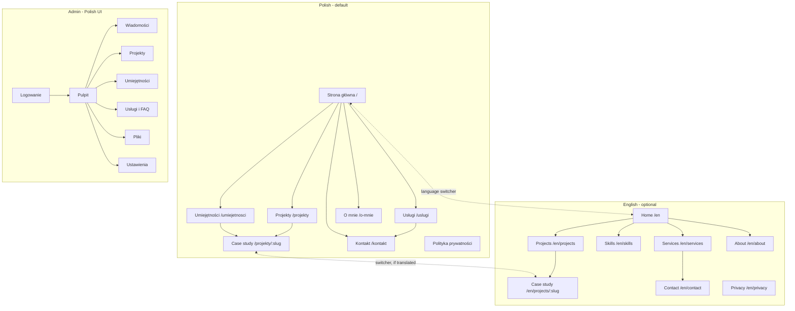

# UI/UX design

This document holds everything that is **shared across screens**: positioning, audiences, information architecture, language behaviour, visual direction, design tokens, components, motion, accessibility and copy rules.

Each individual screen (layout, content, data, states, technical hints) is specified once in [`docs/screens/`](screens/). When a screen spec and this document disagree, fix one of them so that only one source remains.

---

## 1. Positioning

The website is a **portfolio that demonstrates a skillset**. It shows what you build, how you build it, and the results, and it makes starting a conversation easy for anyone who needs that work done.

It is deliberately **not** a job-seeking site:

- No CV download, no "hire me" or "open to work" messaging, no career timeline with employers.
- Services are presented as an offer from an independent engineer, not as a request for work.
- Availability is a calm status for new projects, shown on the Services and Contact pages only.

The tone is "here is what I build and how", backed by evidence: case studies, measurable outcomes, working code, and the site itself.

---

## 2. Audiences

| Audience | Arrives from | What they want to know | Success looks like |
|---|---|---|---|
| Potential client (company, startup, agency) | Referral, search, social profile | "Can this person build what we need, and how do we start?" | Reads a case study or Services, sends a message |
| Technical evaluator (tech lead, CTO, fellow developer) | GitHub, a shared project link, a talk or article | "How good is the engineering?" | Reads a case study in depth, opens the repo |
| Collaborator / community | GitHub, events, social | "What does this person work on?" | Follows links, gets in touch |

Design consequences:

- The home page shows proof first: selected projects and areas of expertise, each linked to evidence.
- The skills page connects every skill to the projects that use it, so claims are verifiable.
- Case studies carry real technical depth: architecture, trade-offs, outcomes, lessons.
- The path to contact is always one click away, without pressure.

---

## 3. Information architecture

### Navigation

| Tab (PL) | Tab (EN) | URL (PL) | URL (EN) | Purpose | Spec |
|---|---|---|---|---|---|
| Graph mark + M. Pospieszyński (logo) | Graph mark + M. Pospieszyński | `/` | `/en` | Overview and proof | [home](screens/public/02-home.md) |
| Projekty | Projects | `/projekty` | `/en/projects` | All work | [projects-list](screens/public/03-projects-list.md) |
| Umiejętności | Skills | `/umiejetnosci` | `/en/skills` | Skillset with evidence | [skills](screens/public/05-skills.md) |
| Usługi | Services | `/uslugi` | `/en/services` | What you offer and how collaboration works | [services](screens/public/06-services.md) |
| O mnie | About | `/o-mnie` | `/en/about` | Who you are and how you work | [about](screens/public/07-about.md) |
| Kontakt | Contact | `/kontakt` | `/en/contact` | Start a conversation | [contact](screens/public/08-contact.md) |

Header extras: the language pill (the other language's code). Nothing else. The footer adds GitHub, LinkedIn, email, the privacy policy and "Jak zbudowana jest ta strona / How this site is built".

### Sitemap



### Key flows

```
Client:      Home ──▶ Selected project ──▶ "Potrzebujesz czegoś podobnego?" ──▶ Kontakt (prefilled)
             Home ──▶ Usługi ──▶ "Zapytaj o tę usługę" ──▶ Kontakt (service preselected)
Evaluator:   Shared link ──▶ Case study ──▶ Repo / demo ──▶ Umiejętności ──▶ other projects
             Home ──▶ Umiejętności ──▶ technology ──▶ projects using it
Owner:       /admin ──▶ Logowanie ──▶ Pulpit ──▶ Wiadomości / content editors
```

---

## 4. Language behaviour

Details and edge cases are implemented in the [app shell spec](screens/public/01-app-shell.md). The rules:

- Polish at `/`, English at `/en/...` with English slugs. The URL decides the language; there is no automatic redirect.
- On Polish pages, browsers preferring English see one dismissible line: "This site is also available in English."
- The `PL | EN` switcher links to the **equivalent page**. A case study without an English version sends the visitor to `/en/projects` with a short note.
- Missing English content: projects are listed with a "Polish only" label; smaller texts (technology descriptions, services, FAQ, about) fall back to Polish, marked `lang="pl"`.
- UI strings are always complete in both languages; CI checks the keys.

---

## 5. Visual direction

**[DIRECTION.md](../DIRECTION.md) is the source of truth** (from the redesign handoff, [redesign/HANDOFF.md](redesign/HANDOFF.md)).
In short: Emerald Ink (deep green ground) with champagne as the single accent; Syne headings and Manrope text;
the home page's signature is an interactive canvas graph of projects and the technologies they share, with a
champagne detail panel. Structure comes from 1px rules between rows; pills for controls; dark and light themes.

### Principles

1. **The work leads.** Projects, their technologies and outcomes come first; the person's name stays small.
2. **One accent.** Champagne marks the primary action, the selection and focus; nothing else competes.
3. **Rules, not boxes.** Hairlines between rows; surfaces only where they hold something (graph card, form card,
   projects band, the champagne panel and call to action).
4. **Everything the graph does is possible without it.** Chips and "Pokaż na grafie" select projects.
5. **Fast is part of the design.** Self-hosted fonts, sized images, a 2D canvas instead of a 3D library.

---

## 6. Design tokens

Defined in `frontend/src/styles/tokens.scss` and documented in [DIRECTION.md](../DIRECTION.md#tokens): the raw
palette (`--ink-900…400`, `--emerald-300`, `--champagne`, text tones), semantic aliases (`--color-ground`,
`--color-band`, `--color-raised(-2)`, `--color-line`, `--color-control`, `--color-field`, `--color-ink`,
`--color-body`, `--color-muted`, `--color-stage` / `--color-stage-ink` for champagne surfaces), type steps,
spacing, layout (`--container`, `--page-gutter`, `--section-pad`), radii and motion
(`--ease-out`, `--dur-*`, `--rise`, `--press`). Components use the semantic aliases only. Every colour pair in use is in
`src/styles/contrast-pairs.json` and must pass `npm run check:contrast`.

### Imagery

- Case studies use the project's own visuals: covers, architecture diagrams, real interface screenshots.
- No stock photography of people, laptops or code on screens.

---

## 7. Shared components

Built in `frontend/src/app/shared/ui/`. Screen specs refer to them by name.

| Component | Selector | Notes |
|---|---|---|
| Button | `ui-button` | Pill. Variants: `primary` (champagne fill), `ink` (ink fill on champagne surfaces), `ghost` (outline; `pressed` sets `aria-pressed` and turns it champagne), `text`. Sizes `md`, `lg`. Renders `<a>` when given a link (with optional `fragment`). |
| Tech tag | `ui-tech-tag` | Text chip linking to `/projekty?tech=<slug>` (or `/en/projects?tech=`) |
| Availability badge | `ui-availability` | Dot + text from settings; never colour alone |
| Project row (featured) | `ui-project-feature` | Image, title, outcome, meta, tags, optional "Polish only" label |
| Project list item | `ui-project-item` | Title, kind, tech, year |
| Section | `ui-section` | Heading + optional intro + content slot; consistent vertical rhythm |
| Markdown | `ui-markdown` | Sanitised render, prose typography, code highlighting, figures, `lang` on fallback text |
| Form field | `ui-field` | Label, hint, error, `aria-describedby` wiring around native inputs |
| Empty state | `ui-empty` | Message + one action |
| Language fallback | `ui-lang-fallback` | Wraps text shown in Polish on English pages (`lang="pl"`) |
| Project graph | `app-project-graph` | Home only: canvas graph of projects and technologies; see the home spec |
| Contact form | `app-contact-form` | Home and contact page; see the contact spec |
| Cookie banner | `app-consent-banner` | App shell only, when analytics is configured: bottom panel with two equal ghost pills (Accept, Reject) and a privacy link; reopened from the footer. See the app-shell spec and [ANALYTICS.md](ANALYTICS.md) |

---

## 8. Motion

Defined in [DIRECTION.md](../DIRECTION.md#motion): the project graph (unfold on first view, slow rotation, drag with
inertia, selection to the front) is the only non-interactive motion; the panel rises in; every control gives press
and hover feedback. Transform and opacity only. Under `prefers-reduced-motion`, `--rise` becomes 0 and `--press`
1, smooth scrolling is off, and the graph neither unfolds nor rotates on its own. Content never depends on motion.

---

## 9. Accessibility (WCAG 2.2 AA)

Applies to every screen; screen specs add only screen-specific points.

- `<html lang>` matches the page; fallback text has its own `lang`.
- Landmarks, one `h1` per page, logical heading order.
- "Przejdź do treści" / "Skip to content" as the first focusable element.
- Visible focus ring: 2 px `--color-focus` (on paper: `--color-paper-ink`), 2 px offset.
- Full keyboard support; the menu sheet traps focus and closes on `Esc`.
- Form errors announced via `aria-live`.
- Alt text required per language before an image is used on a translated page.
- Touch targets at least 44 × 44 px.

---

## 10. Copy rules

### Voice

First person, plain verbs, sentence case, specific and calm. Lead with outcomes: "Nocne przetwarzanie skrócone z 4 h do 25 min" beats "Optymalizacja przetwarzania wsadowego". No job-seeking language: avoid "szukam pracy", "open to work", "zatrudnij mnie / hire me".

### Polish rules

- **Gender:** use your own forms in personal text. In UI templates prefer neutral constructions: present/future tense ("Odpowiem w ciągu dwóch dni"), nouns ("Rozwiązanie", "Wolne terminy").
- **Address:** informal "ty" throughout ("Opisz swój projekt").
- **Typography:** quotation marks „…”; non-breaking space after single-letter words (w, z, i, o, u, a); spaced en dash ( – ) in sentences; unspaced en dash in ranges (2020–2023).
- **Numbers and dates:** from the Angular locale (decimal comma, space as thousands separator, "październik 2026").
- **Plurals:** ICU MessageFormat (one / few / many / other).

### English

Write for an international reader rather than translating word for word.

### Shared vocabulary

| Action | Polish | English |
|---|---|---|
| Open projects | Zobacz projekty | See projects |
| Contact CTA | Porozmawiajmy o projekcie | Let's talk about your project |
| Read a case study | Czytaj case study | Read case study |
| Ask about a service | Zapytaj o tę usługę | Ask about this service |
| Send form | Wyślij wiadomość → Wiadomość wysłana | Send message → Message sent |
| Save (admin) | Zapisz → Zapisano | – |
| Publish (admin) | Opublikuj → Opublikowano | – |

---

## 11. Responsive rules

| Breakpoint | General behaviour |
|---|---|
| < 640 px | Navigation in a menu sheet; language switcher stays in the top bar; single column; base font 16 px |
| 640–959 px | Two-column grids where specified |
| 960–1279 px | Full layouts; check that five Polish tabs fit on one line, otherwise switch to the menu sheet below 1100 px |
| ≥ 1280 px | Content capped at 1200 px |
